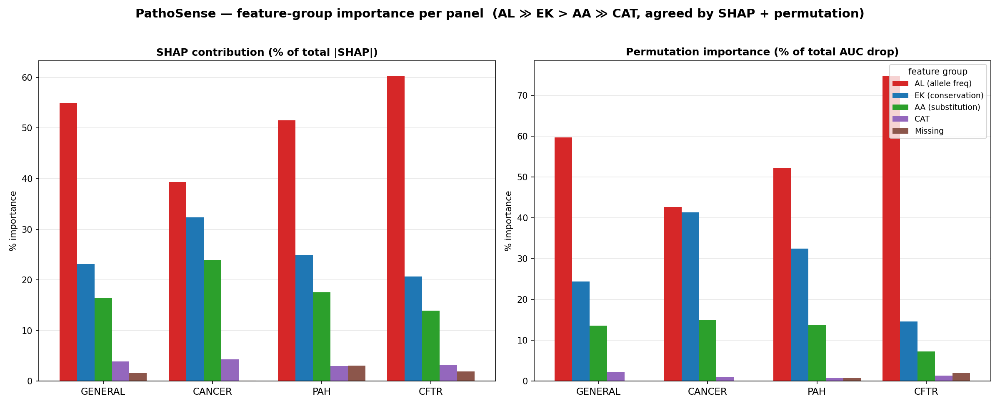

# PathoSense

Classifying missense genetic variants as pathogenic or benign, from an anonymized
feature matrix, scored at a low pathogenic prevalence.

Built for the TEKNOFEST 2026 "AI in Health" university track. There are four gene
panels (`general`, `cancer`, `pah`, `cftr`), each with its own model, each scored by
binary F1 on the pathogenic class.

## Results

Repeated stratified cross-validation, with F1 computed analytically at each panel's
test prevalence. Preprocessing, feature selection, calibration and threshold are all
fit inside the training folds.

| panel | test prior π | threshold | F1* | AUC | MCC | PR-AUC |
|---|---|---|---|---|---|---|
| general | 0.143 | 0.81 | 0.537 | 0.863 | 0.460 | 0.504 |
| cancer  | 0.167 | 0.80 | 0.725 | 0.940 | 0.671 | 0.772 |
| pah     | 0.286 | 0.82 | 0.669 | 0.802 | 0.517 | 0.615 |
| cftr    | 0.167 | 0.90 | 0.851 | 0.965 | 0.830 | 0.879 |

Unweighted mean F1* = 0.696.

A single 80/20 split reports far higher numbers for the same models (0.89 to 0.95).
Those numbers are wrong, and most of this repository exists because we spent weeks
believing them. See [Evaluation](#evaluation).

## What makes the problem awkward

**The test set inverts the class balance.** Training data is 70-83% pathogenic. The
test set simulates clinical prevalence and is mostly benign, at the per-panel priors
in the table above. A threshold picked at the training prior is badly placed for
deployment, so every threshold here is optimized at the test prior instead of at 0.5.
Nothing else we tried moved F1 as much.

**The features are anonymized, and cannot be enriched.** Columns arrive de-identified
into four families: `AA_1`/`AA_2` (reference and alternate amino acid), `EK_*`
(evolutionary conservation), `AL_*` (about 300 transformed allele-frequency columns),
and `CAT_*` (population and region flags). There is no gene, no genomic coordinate, no
residue position, no sequence context, and no in-silico score. We tried to match rows
back to public databases (dbNSFP, gnomAD) and could not: conservation values drift
between builds, and the allele frequencies have been transformed past the point where
they can be matched. So protein language models, external annotation and per-variant
lookup are all off the table. The model gets the released columns and nothing else.

## Method

### Cross-panel transfer

`cancer`, `pah` and `cftr` have a few hundred rows each, which is not enough. A model
trained on the large `general` panel scores their variants better than models trained
on the panels themselves.

The control has to be strict, because 63-69% of the small panels' variants also appear
in `general`. The scorer for a panel is trained on `general` with every one of that
panel's `Variant_ID`s removed. With that in place the transfer AUCs are cftr 0.96,
cancer 0.94, pah 0.80, all at or above what the panel's own model manages. For `cftr`
this is the difference between F1* 0.53 and 0.85.

Deployment blends the two: `probs = w * transfer + (1 - w) * own`.

| panel | w | own model | transfer scorer |
|---|---|---|---|
| general | (the transfer source) | native-NaN, all features, LightGBM + RF + CatBoost + XGBoost | |
| cancer | 0.5 | median + mRMR LightGBM | LGBM + RF + CatBoost, `AL_` replaced by missingness family-flags |
| pah | 1.0 | not built | single LightGBM, with target-rank `AL_` domain adaptation |
| cftr | 1.0 | not built | LGBM + RF + CatBoost |

`AL_` values do not survive the trip between panels (the organizers re-extracted
allele frequencies per panel, so the same variant can carry uncorrelated values in two
panels). Their *within-panel* ordering does survive, which is why `pah` re-ranks them
on its own distribution and `cancer` throws the values away and keeps only which
cohorts were missing.

### Nothing is imputed

An allele-frequency column is absent when that cohort was never measured, which tracks
rarity, which tracks pathogenicity. Dropping that signal costs more than the missing
values cost. NaN is kept and handed to LightGBM's native handling.

Measured on the general panel, against native NaN: median imputation -5.4σ, KNN -6.1σ,
MICE -7.9σ, and imputation plus explicit missingness indicators still -4σ. Scaling and
power transforms do nothing for trees. UMAP and PCA are a disaster at -22σ.

### Substitution chemistry, rebuilt

The anonymization strips the biochemistry, so `feature_engineering.py` derives it back
from `AA_1 -> AA_2`: BLOSUM62, Grantham distance, and deltas in hydrophobicity,
polarity, molecular weight and volume.



Allele frequency carries most of the signal, conservation next, then the engineered
substitution features. SHAP and group permutation importance agree on the ordering.
Regenerate with `analysis/make_shap_figure.py`.

Full write-up in [`docs/METHODS.md`](docs/METHODS.md). Code map in
[`pipelines/README.md`](pipelines/README.md).

## Evaluation

`analysis/harness.py` computes F1 at the test prior analytically from per-fold TPR and
FPR, under paired `RepeatedStratifiedKFold`, with every step fit inside the fold.

This matters more than it sounds. An earlier version of this project fit preprocessing
and feature selection on the whole panel, including the rows it then scored. That put
the mean F1* at roughly 0.64. The honest number at the time was 0.558. Weeks of tuning
went into chasing a gap that did not exist, and fixing the leak is what surfaced
cross-panel transfer in the first place.

A change ships only if it clears 2σ on paired folds, holds across seeds, and can be
justified without looking at test data. Most changes do not clear that bar.
`analysis/exp_*.py` is the full record, including roughly 60 rejected ideas. Almost all
of them move AUC by approximately nothing, which is the useful result: the `general`
panel is limited by its features, not by the model. F1 = 0.70 at π = 0.143 needs
AUC around 0.94. These columns support about 0.86.

`tests/test_batch_invariance.py` checks that a row scores identically alone and in any
batch, on all four panels.

## Running it

```bash
uv venv --python 3.12 .venv          # the pinned scientific stack does not build on 3.14
uv pip install -r requirements.txt

.venv/bin/python pipelines/predict.py train --panel all

.venv/bin/python pipelines/predict.py infer --panel cftr \
    --input test.csv --output predictions.csv

.venv/bin/python analysis/harness.py
.venv/bin/python tests/test_batch_invariance.py
```

`infer` writes `Variant_ID, prediction, probability`. Training is seeded and
deterministic.

### Interface

`app/app.py` is a Streamlit workspace over the saved models, in Turkish (default)
and English. **Overview** brings together canonical cross-validated results, the
prevalence explorer, scoring flow and feature-family reference. **Predictions** scores
a CSV and clearly separates batch/training-sample metrics from canonical results.
**Variant review** audits a selected variant with LightGBM-member TreeSHAP contributions,
reached by clicking a row of the results table or from the link in the Predictions toolbar.
The source is implicit: with a file loaded the upload is scored, otherwise a fixed 300-row
seed-42 sample of the panel; removing the file returns to that sample. Panel, uploaded file
and shared filters persist across navigation. Remove the active file before replacing it.
It never retrains; every probability it shows is the one `infer` writes.

```bash
uv pip install -r app/requirements.txt
.venv/bin/python -m streamlit run app/app.py                     # Turkish
PATHOSENSE_LANG=en .venv/bin/python -m streamlit run app/app.py  # English
```

The language is chosen when the interface starts and does not change while it runs.

`pipelines/explain.py` holds the explainability logic and `tests/test_explain.py`
checks it against the trained artifacts. After installing `app/requirements.txt`, run
`.venv/bin/python tests/test_app.py` for interface state and input regression checks
(requires local models and panel CSVs).

## Layout

```
pipelines/          the deployed system
  predict.py          entry point: train (fit and save) / infer (score a CSV)
  transfer.py         cross-panel transfer scorer and per-panel weights
  general_blend.py    RF + CatBoost + XGBoost blend for the general panel
  preprocess_v2.py    native-NaN preprocessing, AL_ family features, fast mRMR
  feature_engineering.py   BLOSUM62, Grantham, biochemical deltas, ACMG flags
  explain.py          TreeSHAP contributions, readable feature names, confidence flags
  schema.py utils.py recipe.py calibration.py models.py config.py
  run_pipeline.py     the old single-split evaluation, kept for its shared helpers

analysis/
  harness.py          the cross-validation evaluator
  exp_*.py            experiments, one per idea, kept whether or not they worked
  explainability.py   SHAP and group permutation importance
  studies/            longer multi-script campaigns, grouped by topic

app/                Streamlit workspace: overview, predictions, variant review
tests/              batch-invariance, explainability and interface regression tests
docs/METHODS.md     methodology
```

`analysis/exp_*.py` are single-question experiments. `analysis/studies/` holds the
longer campaigns that ran over several scripts: the amino-acid and categorical feature
ablations, the baseline model search, the candidate selection ladder, the categorical
rework, the preprocessing audit. Several people ran these in parallel on the same four
panels and we merged what survived the harness into `pipelines/`. `git log` shows who
did what.

## Data

The panel CSVs come from the competition organizers and we cannot redistribute them.
The pipeline expects them at `data/panels/YARISMA_TRAIN_{MASTER,KANSER,PAH,CFTR}.csv`.
Trained models are written to `models/` by `predict.py train`.

## License

MIT, see [LICENSE](LICENSE).
